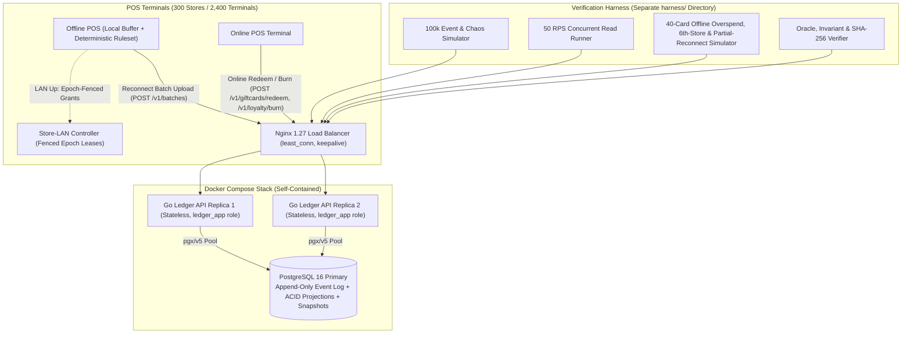
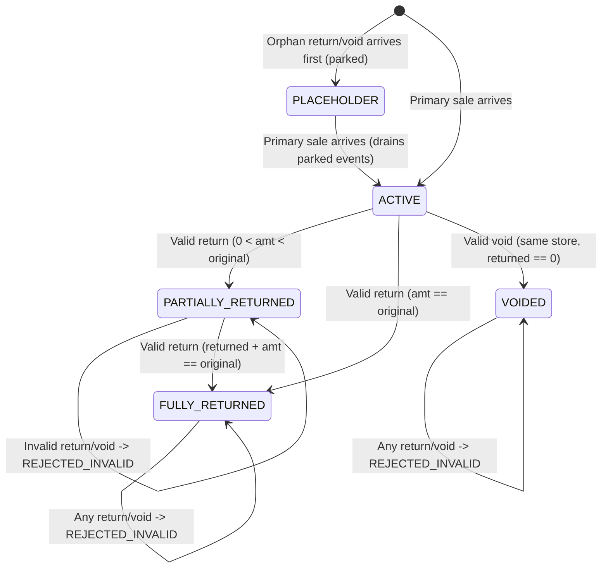

# Phase 1: Architecture & Trade-Off Specification (v10)

## 1. System Overview & Architectural Principles

We are designing a production-complete **Offline-First POS Distributed Ledger** for a 300-store, 2,400-terminal grocery chain where terminals endure up to 6-hour outages and upload buffered event batches on reconnection (at-least-once, duplicated, out of order, up to 48 hours late).

We own both:
1. **Central Ledger & Two-Replica Stateless API**: Append-only event store + ACID read-model projections + consistent-watermark incremental snapshotting, running locally via `docker compose up` (Nginx + 2 stateless Go replicas + PostgreSQL 16).
2. **Deterministic POS Offline Ruleset**: A standalone, zero-dependency rules engine executed by POS terminals while offline (and invoked by the harness simulator) enforcing bounded offline gift-card spend, 5-store offline eligibility clusters, store-epoch terminal fencing, local loyalty accounting, and deterministic event construction.

**Design Principle**: Keep the infrastructure self-contained and lean (`docker compose up` with Nginx + 2 stateless Go replicas + PostgreSQL 16 + separate `harness/`). Use PostgreSQL 16 ACID transactions, MVCC snapshot isolation, `pg_export_snapshot()` + `SET TRANSACTION SNAPSHOT`, and row-level locking rather than introducing distributed brokers or extra services where relational ACID guarantees are strictly stronger.

---

## 2. Component Architecture & Stack



### Locked Technology Stack
| Component | Choice | Justification |
| :--- | :--- | :--- |
| **Load Balancer** | `nginx:1.27-alpine` | L7 `least_conn` routing across `api-1` and `api-2`, passive health checks, upstream keepalive pooling. |
| **API / Ingest (x2)** | **Go 1.23** (`net/http` + `pgx/v5` + embedded `tzdata`) | Strict `int64` minor-unit arithmetic (zero float risk), no GIL contention under 50 RPS reads + bulk ingest, deterministic canonical serialization, tiny static image. |
| **Database** | `postgres:16-alpine` | Single ACID engine for append-only `ledger_events`, synchronous projections, `REPEATABLE READ` snapshots, `xid8`/`pg_snapshot` watermarks, role-isolated immutability triggers. |
| **POS Offline Ruleset** | Pure deterministic module (`pos_ruleset` in Go + mirrored spec in `harness/`) | Zero external dependencies; enforces exact offline gift-card caps, 5-store eligibility clusters, store-epoch terminal fencing, split-brain-safe terminal partitioning, and local loyalty rules. |
| **Verification Harness** | **Python 3.12** (`httpx`, `asyncio`, `psycopg`) in `harness/` | Completely isolated from application code; implements independent reference oracle, 100k chaos replay, 50 RPS reader, 40-card + 6th-store + partial-reconnect offline tests, cross-endpoint race tests, separate-tx late-void rebuild tests, DST/day-close tests, and snapshot/rebuild SHA-256 checks. |

---

## 3. Core Invariant Designs & Trade-Off Resolutions

### 3.1 Event Ingestion, Idempotency, Payload Conflict Detection & Exact Application Ordinal
- **Deterministic Payload Hash**: Before touching PostgreSQL, the API canonicalizes every incoming event into a strict byte representation of `(event_type, store_id, terminal_id, occurred_at_utc_us, canonical_payload_json)` and computes `payload_hash = SHA-256(...)`.
- **Pre-Insert Topological Sorting (Guaranteeing `applied_order` == Projector Order)**:
  - Before opening the DB transaction, the API deduplicates identical `(event_id, payload_hash)` within the incoming HTTP batch (rejecting same-batch `event_id` with different `payload_hash` with `409 EVENT_ID_PAYLOAD_MISMATCH`) and sorts all batch events into the **exact** topological projector order:
    1. Phase 1: `sale` (`occurred_at ASC, event_id ASC`)
    2. Phase 2: `return`, `void` (`occurred_at ASC, event_id ASC`)
    3. Phase 3: `giftcard_redeem`, `loyalty_earn`, `loyalty_burn` (`occurred_at ASC, event_id ASC`)
- **Exactly-Once Across Two Replicas**:
  1. Open a single PostgreSQL transaction (`READ COMMITTED`).
  2. Acquire canonical row locks in fixed global table order (`sales` → `store_business_days` → `gift_cards` → `loyalty_accounts` → `store_offline_epochs` → `terminal_offline_slices`), sorted ascending by primary key within each table.
  3. Check `online_action_receipts` for any batch `event_id` that was previously `DECLINED` online: if `payload_hash` mismatches → rollback with `409 EVENT_ID_PAYLOAD_MISMATCH`; if `payload_hash` matches a `DECLINED` online receipt → skip as already declined.
  4. Insert the **pre-sorted** batch events into `ledger_events` **in that exact topological projector order**, allocating monotonic `applied_order = nextval('ledger_applied_order_seq')` per inserted event **after** acquiring entity row locks, using `ON CONFLICT (event_id) DO NOTHING RETURNING event_id`.
  5. For every `event_id` **not** returned (already existed in `ledger_events`): fetch its persisted `payload_hash`.
     - If `existing.payload_hash == incoming.payload_hash` → true idempotent duplicate (no-op).
     - If `existing.payload_hash != incoming.payload_hash` → **rollback the entire batch transaction** and return `409 Conflict` (`EVENT_ID_PAYLOAD_MISMATCH`) naming the conflicting `event_id`.
  6. Execute the projector **event-by-event** over the newly inserted events in `applied_order ASC` order, using the **prefix-scoped projection rule** (§3.2).
- **Deadlock Retry**: Transient deadlocks (`40P01`) or serialization errors (`40001`) retry cleanly up to 5 times with exponential backoff + jitter.

---

### 3.2 Serialized Orphan/Sale Resolution & Prefix-Scoped Per-Sale State Machine

#### Eliminating the Missing-Key Race Across Two Replicas
Every transaction referencing `sale_id = S` (whether a `sale`, `return`, or `void`) executes the identical lock-acquisition pattern in sorted `sale_id` order:
```sql
INSERT INTO sales (sale_id, status) VALUES ($S, 'PLACEHOLDER')
ON CONFLICT (sale_id) DO NOTHING;
SELECT * FROM sales WHERE sale_id = $S FOR UPDATE;
```
Both `sale` and `return`/`void` paths serialize on the exact same row in `sales`, eliminating the missing-key race across two replicas.

#### Orphan Resolution Posting Timestamp (`resolved_at_utc`)
- When an orphan `return`/`void` arrives before its parent `sale`, it is durably appended to `ledger_events` and inserted into `parked_events (status = 'PENDING_PARENT')` with zero effect on `store_day_totals`.
- When the parent `sale` arrives, the ledger marks each parked orphan `RESOLVED` and persists **`resolved_at_utc = parent_sale.ingested_at`** on `parked_events`.
- **Posting Rule**: The resolved orphan uses **`resolved_at_utc`** (never the orphan's original `ingested_at`) to check whether its `origin_business_day` is closed and to compute `posting_business_day = business_day(resolved_at_utc, store_tz)`.
  - *Worked Example (Monday Orphan / Tuesday Sale)*: Orphan `return` for a Monday sale arrives Monday 10:00 local and is parked. Monday closes Tuesday 02:00 local. Parent `sale` arrives Tuesday 09:00 local (`resolved_at_utc = Tuesday 09:00`). Because Monday is closed at `resolved_at_utc`, both the late `sale` and the resolved `return` post as linked adjustments in **Tuesday's** open business day (`posting_business_day = Tuesday`, `origin_business_day = Monday`), leaving Monday's closed totals untouched.

#### Prefix-Scoped Canonical Recomputation & Deterministic Reclassification History



- **Strict Event-Prefix Visibility Rule (Solving Rebuild Reclassification Equivalence)**:
  - Both **live projection** and **rebuild projection** (full rebuild and snapshot+tail rebuild) invoke the **exact same single-event projector** `projectEvent(tx, e)` in `ORDER BY applied_order ASC`.
  - Whenever `projectEvent(tx, e)` recomputes state for `sale_id = S` (or `card_id = C`, or `account_id = A`), its query over `ledger_events` **MUST enforce the strict event-prefix bound** (with `return` and `void` events explicitly normalizing `sale_id = parent_sale_id` on `ledger_events` so the single indexed `sale_id` predicate includes the parent `sale` and all child `return`/`void` events):
    ```sql
    SELECT * FROM ledger_events
    WHERE sale_id = $S
      AND applied_order <= $e.applied_order
    ORDER BY occurred_at ASC, event_id ASC;
    ```
  - **Proof of Bit-for-Bit Live == Rebuild Equivalence**:
    - *Case A (Separate Transactions)*: Tx 1 commits `sale` (`applied_order = 1`), Tx 2 commits `return(10:05)` (`applied_order = 2`), Tx 3 commits `void(10:02)` (`applied_order = 3`).
      - Live Tx 2 sees prefix `applied_order <= 2` (`{sale, return}`) → applies `return`. Live Tx 3 sees prefix `applied_order <= 3` (`{sale, void, return}`) → applies `void` and flips `return` to `REJECTED_INVALID`, emitting a `RECLASSIFICATION` row at `revision = 2`.
      - Full Rebuild replays `applied_order = 1`, then `2` (prefix `<= 2` sees **only** `{sale, return}` → applies `return`), then `3` (prefix `<= 3` sees `{sale, void, return}` → emits the **exact same** `RECLASSIFICATION` row at `revision = 2`)!
    - *Case B (Reversed Single Batch)*: A single batch supplies `[return(10:05), void(10:02)]` for an existing `sale` (`applied_order = 1`). Pre-sorting assigns `void(10:02)` → `applied_order = 2` and `return(10:05)` → `applied_order = 3`. Both live projection and rebuild process `applied_order = 2` (`void` applied) then `applied_order = 3` (`return` immediately `REJECTED_INVALID`, zero reclassification row).
- **Duplicate `sale_id` & Transitions**:
  - The earliest `sale` in `(occurred_at ASC, event_id ASC)` is primary; any subsequent `sale` with a distinct `event_id` is marked `REJECTED_INVALID` (`DUPLICATE_SALE_ID`), excluded from totals.
  - Invalid transitions (`RETURN_EXCEEDS_REMAINING`, `CANNOT_VOID_RETURNED_SALE`, `CANNOT_RETURN_VOIDED_SALE`, `ALREADY_VOIDED`, `ALREADY_FULLY_RETURNED`, `VOID_STORE_MISMATCH`, `DUPLICATE_SALE_ID`, `INVALID_AMOUNT`) are retained in `ledger_events` and excluded from totals.
  - When a late earlier event flips a previously applied event, `sales.revision` increments under the `sales` lock and a signed `RECLASSIFICATION` adjustment (`caused_by_event_id = e.event_id`, `revision = sales.revision`) posts to the current open `posting_business_day` linked to the flipped event's `origin_business_day`, never mutating a closed day.

---

### 3.3 Immutable Business Day Close (02:00 Cutoff), Timing/Retry Contract & Role Isolation

#### Timezone, DST, Pinned Persistence & Simulated Clock
- Each store has an immutable IANA timezone resolved via Go's embedded `tzdata`.
- **Half-Open Interval**: Business day `D` spans `[cutoff(D-1), cutoff(D))`, where `cutoff(D)` is `02:00:00.000000` store-local time on calendar date `D+1` (`01:59:59.999999` belongs to `D-1`; `02:00:00.000000` belongs to `D`).
- **DST Rules**:
  - *Spring-forward gap* (02:00 local skipped → 03:00 DST): `cutoff(D)` is the first valid UTC instant at or after `02:00` local on `D+1` (`03:00:00` DST).
  - *Fall-back fold* (01:00–01:59 occurs twice): Both `01:xx` hours precede `02:00:00` standard time and belong to `D-1`; `02:00:00` standard time is unambiguous.
- **Pinned Timezone Metadata**: `ledger_events` persists `origin_business_day`, `origin_cutoff_utc`, and `tz_version`; `store_business_days` persists `cutoff_utc` and `tz_version`.
- **Clock-Skew & Lateness Validation**: Reject `occurred_at > ingest_now + 5m` (`400 FUTURE_TIMESTAMP_EXCEEDED`); accept up to `48h` late (`occurred_at >= ingest_now - 48h`, else `400 EVENT_TOO_OLD`).
- **Simulated Ingest Clock (Test Only)**: `X-Simulated-Now: <RFC3339-UTC>` gated by `ALLOW_SIMULATED_CLOCK=true` (production default `false`).

#### Explicit Day-Close Timing, Idempotency & Rebuild Contract (`POST /v1/stores/{id}/days/{day}/close`)
- **Early-Close Rejection**: Closing `business_day = D` before `cutoff_utc(D)` (`ingest_now < cutoff_utc(D)`) is strictly rejected with **`409 Conflict` (`BUSINESS_DAY_CUTOFF_NOT_REACHED`)**.
- **Deterministic Idempotent Retries**: Close `event_id` is `UUIDv5(NAMESPACE_DAY_CLOSE, store_id + ":" + business_day)`. Under `SELECT ... FOR UPDATE` on `store_business_days(store_id, business_day)`:
  1. If `status == 'CLOSED'`: return `200 OK` with existing `closed_at_utc` and deterministic `event_id` (zero duplicate `day_close` events).
  2. If `status == 'OPEN'` and `ingest_now < cutoff_utc(D)`: rollback and return `409 BUSINESS_DAY_CUTOFF_NOT_REACHED`.
  3. If `status == 'OPEN'` and `ingest_now >= cutoff_utc(D)`: append the single `day_close` event (with post-lock `applied_order`) to `ledger_events`, set `store_business_days.status = 'CLOSED'`, commit, and return `200 OK`.
- Full and snapshot+tail rebuilds replay `day_close` events in `applied_order ASC`, reconstructing `store_business_days` (including empty closed days) bit-for-bit.

#### Dual-Role Closed-Day Immutability Isolation
- **`ledger_app`** (API replicas): `INSERT`/`SELECT` on `ledger_events` (no `UPDATE`/`DELETE`); strictly subject to `BEFORE INSERT OR UPDATE OR DELETE` immutability triggers on `store_day_totals` and `store_day_adjustments` for `CLOSED` days and `CLOSED -> OPEN` guard on `store_business_days`. Zero bypass capability.
- **`ledger_admin`** (schema owner, isolated admin DSN): Owns `SECURITY DEFINER` procedure `admin_reset_read_models()` used exclusively for full/snapshot rebuilds.

---

### 3.4 Unified Claim-First Online Idempotency (`online_action_receipts`) & Gift-Card Chain-Wide Hard Bound

#### Unified Claim-First Online Action Protocol & Batch/Online Race Resolution (`POST /v1/giftcards/redeem`, `POST /v1/loyalty/burn`)
Both endpoints share `online_action_receipts(event_id, action_type, payload_hash, status, http_status, response_body)` and share the `event_id` uniqueness contract with `ledger_events`. Both reject non-positive amounts/points (`<= 0`) with `400 INVALID_AMOUNT`.

Single ACID transaction:
1. Compute canonical `payload_hash`.
2. Atomically claim `event_id` **first**:
   ```sql
   INSERT INTO online_action_receipts (event_id, action_type, payload_hash, status)
   VALUES ($1, $2, $3, 'PENDING')
   ON CONFLICT (event_id) DO NOTHING
   RETURNING event_id;
   ```
3. **If conflict (0 rows returned)**: `SELECT payload_hash, status, http_status, response_body FROM online_action_receipts WHERE event_id = $1 FOR UPDATE;` (blocks until winner commits). If `existing.payload_hash != incoming.payload_hash` → rollback and return `409 EVENT_ID_PAYLOAD_MISMATCH`. Otherwise return the winner's stored `(http_status, response_body)` without touching `gift_cards` or `loyalty_accounts`.
4. **If winner (1 row returned)**:
   - Acquire canonical locks (`store_business_days`, `gift_cards` or `loyalty_accounts`) in sorted order.
   - Check/serialize against `ledger_events` via `event_id`:
     - **If `event_id` already exists in `ledger_events` (Batch won the race or committed earlier)**:
       - If `existing.payload_hash != incoming.payload_hash`: rollback (rolling back `PENDING` receipt) and return `409 EVENT_ID_PAYLOAD_MISMATCH`.
       - If `existing.payload_hash == incoming.payload_hash`: do **not** double-debit; **finalize** `online_action_receipts` (`SET status = 'APPROVED', http_status = 200, response_body = <canonical idempotent response>`), commit, and return `200 OK`.
     - **If `event_id` is new**:
       - Validate `status == 'ACTIVE'` and sufficient balance/points. If declined: finalize receipt (`DECLINED`, `409`), commit, return `409`.
       - If approved: insert into `ledger_events` with `ON CONFLICT (event_id) DO NOTHING RETURNING event_id` (if a racing batch just committed it, unique-index lock serializes and executes the "Batch won the race" branch above, finalizing the receipt to `APPROVED`/`200` without double-debiting!). Otherwise update card/account + `store_day_totals`, finalize receipt (`APPROVED`, `200`), and commit.

#### Offline Gift-Card Redemption: Chain-Wide Hard Bound ($L = \$125.00$) & Store-Epoch Renewal Barrier
- **Single Unambiguous Chain-Wide Hard Upper Bound**: **$L = 12500$ minor units (\$125.00)** incremental offline overdraft per gift card across the entire 300-store chain, enforced by:
  1. `GIFT_CARD_OFFLINE_STORE_CAP_MINOR`: $C_{\text{store}} = 2500$ minor units (\$25.00 per eligible store per offline epoch).
  2. `GIFT_CARD_MAX_OFFLINE_STORES`: $K_{\max} = 5$ eligible offline stores per card (`eligible_offline_stores(card_id)`). **Cluster Immutability**: `eligible_offline_stores(card_id)` is **immutable for the lifetime of the card** (enforced by a DB trigger forbidding updates to `gift_cards.eligible_stores`), guaranteeing old and new store sets can never be spendable concurrently. Any 6th disconnected store outside the card's 5-store cluster deterministically rejects offline redemptions (`OFFLINE_STORE_NOT_ELIGIBLE`).
  3. **Multi-Terminal Partitioning**: Each terminal $t \in \{1, \dots, T_s\}$ in store $s$ holds a static, non-overlapping slice $C_{\text{term}}(s, t) = \lfloor C_{\text{store}} / T_s \rfloor$ (with Store-LAN Controller pre-reserving fallback slices before issuing fenced, epoch-versioned leases when LAN is up), ensuring $\sum_{t=1}^{T_s} S_{s,t} \le C_{\text{store}}$ even under LAN split-brain.
- **Store-Epoch Renewal Barrier, Immutable Roster & Zero-Overlap Expiry Proof**:
  - Central ledger persists `store_offline_epochs(store_id, active_epoch_gen, roster_terminal_count, state)` and per-terminal slice grants `terminal_offline_slices(store_id, terminal_id, epoch_gen, slice_minor, issued_at_utc, slice_expires_at_utc, hq_boot_id, hq_issued_mono_ms, state: ACTIVE | RECONCILED | FENCED)`.
  - **Immutable Per-Epoch Terminal Roster**: Terminal membership ($T_s$) and slice allocations for `active_epoch_gen` are **immutable for the lifetime of that epoch** (enforced by DB trigger/check on `terminal_offline_slices`). A terminal cannot be removed, replaced, or have its slice reallocated until its `epoch_gen` slice is `RECONCILED` or `FENCED`; roster changes take effect exclusively on `epoch_gen + 1`.
  - **Trusted Terminal Elapsed-Time Source & Quantitative Drift Envelope**:
    - Terminals measure elapsed lease time using **`CLOCK_BOOTTIME`** (monotonic clock that **continues advancing across OS suspend/sleep**; if the host OS lacks `CLOCK_BOOTTIME` or detects suspend/resume without hardware RTC verification, the terminal fails closed and permanently fences its local slice on resume, identical to offline reboot).
    - **Quantitative Max Oscillator Rate Error**: POS hardware oscillators are bounded by $\rho_{\max} = 1000\text{ ppm} = 0.1\%$ ($10^{-3}$, 5× more conservative than standard $200\text{ ppm}$ quartz). HQ monitors observed terminal clock drift across syncs; any terminal exceeding $\rho_{\max}$ is marked `CLOCK_DEGRADED` and granted `offline_allowance_minor = 0`.
    - **Pre-Request Monotonic Timestamping**: Before sending its sync request to HQ, the terminal records `grant_boottime_ms` ($M_{\text{req}}$) and `boot_id`. If sync round-trip time exceeds $\epsilon_{\text{rtt}} = 30\text{ s}$, the terminal discards the grant. Because $M_{\text{req}}$ is captured *before* HQ issues the grant ($T_{\text{hq\_issue}}$), the terminal's local TTL countdown starts strictly $\le T_{\text{hq\_issue}}$.
    - Every offline spend enforces four fail-closed local checks: (1) `local_fenced == false`, (2) `boot_id` unchanged (fail-closed on offline reboot), (3) `wall_clock >= hwm_utc` (backward rollback fails closed), and (4) `boottime_now - grant_boottime_ms < TTL` ($\text{TTL} = 6\text{ h} = 21{,}600\text{ s}$) AND `wall_clock < slice_expires_at_utc`.
  - **HQ Monotonic Elapsed-Time Guard & Derived Fence Threshold**:
    - HQ measures slice expiry using a **monotonic elapsed-time clock** (`CLOCK_MONOTONIC` / PostgreSQL server-uptime delta anchored per `epoch_gen` via `(hq_boot_id, hq_issued_mono_ms)`) with $\rho_{\text{hq}} \le 1000\text{ ppm}$ — never relying on jumpable wall-clock alone.
    - **HQ Fail-Closed Step/Restart Guard**: If HQ/PostgreSQL restarts (`current_hq_boot_id != hq_boot_id`) or detects a wall-clock/NTP step exceeding tolerance (`|wall_delta - mono_delta| > 5s`), HQ **fails closed** on timeout-based fencing for pre-restart/stepped slices, requiring direct terminal `RECONCILED` before advancing `active_epoch_gen`.
    - Under worst-case opposite clock drift (terminal slow by $1 - \rho_{\max}$, HQ fast by $1 + \rho_{\text{hq}}$) plus $\epsilon_{\text{rtt}} = 30\text{ s}$, the maximum HQ-clock duration before an isolated terminal's `CLOCK_BOOTTIME` expires locally is:
      $$\Delta_{\text{worst}} = \left\lceil \text{TTL} \cdot \frac{1 + \rho_{\text{hq}}}{1 - \rho_{\max}} \right\rceil + \epsilon_{\text{rtt}} = \left\lceil 21600 \cdot \frac{1.001}{0.999} \right\rceil + 30 = 21644 + 30 = 21674\text{ s} \approx \text{TTL} + 74\text{ s}$$
    - Adding a conservative safety margin yields HQ's mandatory fencing threshold:
      $$\Delta_{\text{hq\_fence}} = \text{TTL} + 600\text{ s} = 22{,}200\text{ s} \quad (\text{both } \texttt{hq\_mono\_elapsed >= 22,200s} \text{ AND } \texttt{ingest\_now >= slice\_expires\_at\_utc + 10m})$$
  - **Per-Card Quota Template Semantics**:
    - `terminal_offline_slices.slice_minor` and `C_store,avail` define a **uniform per-card quota template** applied **independently to every eligible gift card $c$** (`store_id IN card.eligible_stores`): each terminal tracks `spent_by_card_minor[card_id] <= slice_minor` independently per card, and every `FENCED` slice reserves `slice_minor` of unreconciled liability **independently for every eligible card $c$** until reconciled.
    - Thus the aggregate invariant holds independently for **every `(card_id, store_id)` pair**:
      $$\sum_{t \in \text{ACTIVE}(s)} C_{\text{term}}(s, t) + \sum_{t \in \text{FENCED\_UNRECONCILED}(s)} C_{\text{term}}(s, t) \le C_{\text{store}} = 2500 \text{ minor units } (\$25.00)$$
  - **Serialized Atomic Reconciliation, Liability Release & Epoch-Advance Transaction (Two-Replica Safe)**:
    - A terminal transitions out of `ACTIVE` **only** via:
      1. **Direct Terminal `RECONCILED`** (`ACTIVE -> RECONCILED`): terminal uploads & HQ acknowledges all buffered prior-epoch events, atomically releasing its liability.
      2. **HQ Monotonic-Timeout `FENCED`** (`ACTIVE -> FENCED`): once both monotonic and wall-clock thresholds $\ge \Delta_{\text{hq\_fence}}$ pass with no HQ restart/NTP step. A `FENCED` slice **retains its full per-card unreconciled liability** $C_{\text{term}}(s, t)$ until the terminal later reconnects, uploads its buffer, and transitions `FENCED -> RECONCILED`.
    - **Single Atomic Transaction & Lock Order**: Terminal sync/reconciliation (`POST /v1/stores/{id}/terminals/{tid}/sync`, carrying any remaining buffered offline events), liability release, and epoch-advance execute inside **one PostgreSQL ACID transaction** following the global canonical lock order (`sales` → `store_business_days` → `gift_cards` → `loyalty_accounts` → **`store_offline_epochs FOR UPDATE`** → `terminal_offline_slices ORDER BY epoch_gen ASC, terminal_id ASC FOR UPDATE`), with bounded retry (up to 5 retries with jitter) on `40P01`/`40001`:
      1. **Ingest & Acknowledge**: Atomically ingest all terminal buffered events into `ledger_events` and update `gift_cards` balances/freeze flags (ensuring any offline spend is reflected centrally *before* liability is released).
      2. **Release Liability**: Transition that terminal's `ACTIVE` or `FENCED` slice row(s) to `RECONCILED`.
      3. **Check Epoch Barrier & Advance Atomically (Idempotent Under `store_offline_epochs FOR UPDATE`)**:
         - Inspect all rows in `terminal_offline_slices` for `(store_id = s, epoch_gen = active_epoch_gen)`. If any sibling terminal is still `ACTIVE`, commit the reconciliation and return `offline_allowance_minor = 0`, `renewal_status = 'BLOCKED_PENDING_SIBLINGS'`.
         - If **every** terminal in `active_epoch_gen`'s immutable roster is `RECONCILED` or `FENCED`:
           - Compute `reserved_liability = SUM(slice_minor)` over all `state = 'FENCED'` rows for store $s$.
           - Compute `C_store_avail = C_store - reserved_liability` (asserting `C_store_avail >= 0`).
           - Increment `store_offline_epochs.active_epoch_gen = active_epoch_gen + 1`.
           - Partition `C_store_avail` across all $T_s'$ terminals in the new epoch's roster (`slice_minor = floor(C_store_avail / T_s')`), assert aggregate cap `T_s' * slice_minor + reserved_liability <= C_store`, and **pre-insert all $T_s'$ rows** into `terminal_offline_slices` (`UNIQUE (store_id, terminal_id, epoch_gen)`) **before commit**.
           - Return the requesting terminal's newly inserted `(store_id, terminal_id, active_epoch_gen + 1)` grant + fresh snapshot of `ACTIVE` cards with `balance_minor > 0`.
         - **Two-Replica Concurrency Guarantee**: Any concurrent sync hitting the second API replica blocks on `store_offline_epochs FOR UPDATE`, observes the already-advanced `active_epoch_gen + 1`, and returns its pre-inserted unique `(store_id, terminal_id, active_epoch_gen + 1)` grant without recomputing or double-allocating `C_store_avail`.
  - **Complete Multi-Epoch Chain-Wide Proof**:
    - Non-overlapping live epochs alone do not bound sequential epochs; the chain-wide bound holds from the combination of **(1) monotonic-clock non-overlap** (fenced slices cannot execute new spend after $\Delta_{\text{hq\_fence}}$), **(2) serialized per-card liability reservation** (`sum(active + fenced_unreconciled) <= $25.00` enforced atomically under `store_offline_epochs FOR UPDATE` for every `(card_id, store_id)` across all sequential epochs), and **(3) immutable 5-store eligibility clusters** ($K_{\max} = 5$):
      $$\forall c,\; \text{UnreconciledOfflineExposure}(c) = \sum_{s \in \text{eligible}(c)} \left(\sum_{t \in \text{ACTIVE}(s)} C_{\text{term}}(s, t) + \sum_{t \in \text{FENCED}(s)} C_{\text{term}}(s, t)\right) \le 5 \times 2500 = 12500 \text{ minor units } (\$125.00) = L$$
    - Thus incremental offline overdraft from any non-negative pre-outage balance ($B_{\text{true}} \ge 0$) is strictly $\le \$125.00$ per card chain-wide across any sequence of epochs (and any stale-snapshot eligible store on an already-negative card is still capped at $C_{\text{store}} = \$25.00$).
- **Reconnection & 100% Overspend Flagging**: Completed offline redemptions are always applied to `gift_cards.balance_minor`. `gift_cards` and `giftcard_overspend_flags` are recomputed prefix-scoped (`applied_order <= e.applied_order`) in canonical `(occurred_at ASC, event_id ASC)` order: any card with `balance_minor < 0` transitions to `OVERSPENT_FROZEN` and every overspending event is recorded in `giftcard_overspend_flags` (**100% flagged**).

---

### 3.5 Convergent Loyalty Accounting
- **Scoped CRDT Convergence**: Balance (`earned_total - burned_total`) and status (`ACTIVE` if `balance >= 0`, else `NEGATIVE_RESTRICTED`) converge deterministically over the **set of accepted events** regardless of upload order. Online `POST /v1/loyalty/burn` accept/reject decisions are arrival-order-dependent relative to unuploaded offline burns; once accepted into `ledger_events`, they belong to the convergent accepted set.
- **Deterministic Negative Flags (`loyalty_negative_flags`)**: Recomputed prefix-scoped (`applied_order <= e.applied_order`) per `account_id` in canonical `(occurred_at ASC, event_id ASC)` order (`trigger_event_id`, `deficit_points`, `resolved_by_event_id`).
- **Offline Cap & Recovery**: Offline terminals enforce `LOYALTY_OFFLINE_STORE_BURN_CAP = 5000` points/store/epoch (subject to the identical store-epoch renewal barrier and terminal slicing; `0` = unlimited for stress tests). Online burns are rejected (`409 ACCOUNT_NEGATIVE_RESTRICTED`) while `balance < 0`; earn-back restores `balance >= 0` and transitions back to `ACTIVE`.

---

### 3.6 Read Isolation (50 RPS Concurrent Reads)
- Every read endpoint executes inside `BEGIN TRANSACTION ISOLATION LEVEL REPEATABLE READ READ ONLY;`, pinning a single transaction-wide MVCC snapshot across all `SELECT`s with zero write locks and guaranteeing **zero partial batch visibility** under 50+ RPS load.

---

### 3.7 Consistent 10M-Event Snapshotting (`SET TRANSACTION SNAPSHOT`), Prefix Replay & Exact SHA-256 Spec

#### Snapshot Capture via `pg_export_snapshot()` + `SET TRANSACTION SNAPSHOT`
1. Every row in `ledger_events` stores `commit_xid xid8 NOT NULL DEFAULT pg_current_xact_id()` (B-tree indexed) and post-lock topological `applied_order BIGINT NOT NULL` (B-tree indexed).
2. **Coordinated Two-Transaction Snapshot Capture** (`POST /v1/admin/snapshots`, running under `ledger_admin`):
   - *Reader Tx*: Opens `BEGIN TRANSACTION ISOLATION LEVEL REPEATABLE READ READ ONLY`, calls `export_id = pg_export_snapshot()` and `pg_snap = pg_current_snapshot()` (capturing `pg_snapshot_text`, `xmin`, `xmax`), and **stays open**.
   - *Writer Tx*: Opens `BEGIN TRANSACTION ISOLATION LEVEL REPEATABLE READ` (read-write), **immediately executes `SET TRANSACTION SNAPSHOT '<export_id>'` before any query**, runs bulk in-DB `INSERT INTO snapshot_<table_name> SELECT $snapshot_id, * FROM <table_name>` directly from the exact exported snapshot, stores `(snapshot_id, pg_snapshot_text, xmin, xmax, read_model_sha256)` in `ledger_snapshots`, and commits.
   - *Reader Tx* closes only after Writer Tx's reads complete.
3. **Incremental Rebuild from Snapshot (`POST /v1/admin/rebuild?mode=snapshot`)**:
   - Calls `admin_reset_read_models()`, bulk-loads `snapshot_*` rows for the latest snapshot `snap`, and replays the exact disjoint tail event-by-event in `ORDER BY applied_order ASC` with prefix visibility `applied_order <= e.applied_order`:
     ```sql
     SELECT * FROM ledger_events
     WHERE commit_xid >= $snap_xmin
       AND NOT pg_visible_in_snapshot(commit_xid, $snap_pg_snap::pg_snapshot)
     ORDER BY applied_order ASC;
     ```
4. **Full Drop & Rebuild (`POST /v1/admin/rebuild?mode=full`)**:
   - Calls `admin_reset_read_models()` and replays all rows of `ledger_events` (including `day_close` events) event-by-event in `ORDER BY applied_order ASC` with prefix visibility `applied_order <= e.applied_order`.
5. **Excluded Arrival-Sensitive Tables**: `online_action_receipts`, `ingest_batches`, and `terminal_offline_slices`/`store_offline_epochs` (operational sync/auth state) are excluded from `read_model_sha256` and `economic_sha256`. `STALE_UNRESOLVED` (>72h orphans) is a read-only SQL view.

#### Exact Canonical SHA-256 Specification (Ordered Columns & Encodings)
Computed inside `REPEATABLE READ READ ONLY`. UTF-8 lines terminated by `\n`; each table prefixed with `#TABLE:<table_name>\n`; columns separated by `\t`.
- **Field Encodings**: `BIGINT`/`INT` → base-10 ASCII; `BOOLEAN` → `true`/`false`; `DATE` → `YYYY-MM-DD`; `TIMESTAMPTZ` → UTC `YYYY-MM-DDTHH:MM:SS.ffffffZ` (6-digit microseconds); `NULL` → `\N`; `TEXT` → compact RFC 8259 JSON string literal (no HTML escaping).

##### 1. `economic_sha256` (Order- & Duplicate-Invariant; Verified Against Harness Oracle)
| Section | `ORDER BY` | Exact Ordered Columns |
| :--- | :--- | :--- |
| `#TABLE:economic_store_day_totals` | `store_id ASC, origin_business_day ASC` | `store_id`, `origin_business_day`, `sales_minor`, `returns_minor`, `voids_minor`, `giftcard_redeem_minor`, `net_sales_minor` *(sum of `store_day_totals` + all `store_day_adjustments` rolled back to `origin_business_day`)* |
| `#TABLE:sales` | `sale_id ASC` | `sale_id`, `store_id`, `origin_business_day`, `status`, `original_amount_minor`, `returned_amount_minor` |
| `#TABLE:gift_cards` | `card_id ASC` | `card_id`, `balance_minor`, `status` |
| `#TABLE:loyalty_accounts` | `account_id ASC` | `account_id`, `earned_total`, `burned_total`, `balance`, `status` |

##### 2. `read_model_sha256` (Live == Full Drop & Rebuild == Snapshot + Tail Rebuild)
| Section | `ORDER BY` | Exact Ordered Columns |
| :--- | :--- | :--- |
| `#TABLE:store_business_days` | `store_id ASC, business_day ASC` | `store_id`, `business_day`, `cutoff_utc`, `tz_version`, `status` |
| `#TABLE:store_day_totals` | `store_id ASC, business_day ASC` | `store_id`, `business_day`, `sales_minor`, `returns_minor`, `voids_minor`, `giftcard_redeem_minor`, `adjustments_net_minor`, `net_total_minor` |
| `#TABLE:store_day_adjustments` | `store_id ASC, posting_business_day ASC, origin_business_day ASC, event_id ASC, entry_kind ASC, revision ASC` | `store_id`, `posting_business_day`, `origin_business_day`, `event_id`, `entry_kind`, `revision`, `caused_by_event_id`, `event_type`, `amount_delta_minor` |
| `#TABLE:sales` | `sale_id ASC` | `sale_id`, `store_id`, `origin_business_day`, `status`, `original_amount_minor`, `returned_amount_minor`, `revision` |
| `#TABLE:parked_events` | `event_id ASC` | `event_id`, `parent_sale_id`, `status`, `resolved_at_utc` |
| `#TABLE:event_application_status` | `event_id ASC` | `event_id`, `status`, `rejection_reason` |
| `#TABLE:gift_cards` | `card_id ASC` | `card_id`, `balance_minor`, `status` |
| `#TABLE:giftcard_overspend_flags` | `card_id ASC, event_id ASC` | `card_id`, `event_id`, `store_id`, `balance_after_minor`, `overspend_delta_minor` |
| `#TABLE:loyalty_accounts` | `account_id ASC` | `account_id`, `earned_total`, `burned_total`, `balance`, `status` |
| `#TABLE:loyalty_negative_flags` | `account_id ASC, trigger_event_id ASC` | `account_id`, `trigger_event_id`, `deficit_points`, `resolved_by_event_id` |

---

## 4. Locked Architectural Parameters (Zero Open Ambiguities)

| Parameter | Locked Value | Config Env Var |
| :--- | :--- | :--- |
| **Stack** | Go 1.23 (`pgx/v5`) API (x2) + Nginx + Postgres 16 + Python 3.12 `harness/` | — |
| **DB Roles** | `ledger_app` (API runtime; zero trigger-bypass rights) + `ledger_admin` (owns `SECURITY DEFINER` rebuild proc) | `DATABASE_URL`, `ADMIN_DATABASE_URL` |
| **Business Day Cutoff** | `02:00:00` store-local time (half-open `[02:00, next 02:00)`), pinned `tz_version`; early close rejected (`409`); retries idempotent via deterministic `UUIDv5` `day_close` event | Per-store IANA TZ |
| **Simulated Clock (Test Only)** | Optional `X-Simulated-Now` header, gated by `ALLOW_SIMULATED_CLOCK=true` (prod default `false`) | `ALLOW_SIMULATED_CLOCK` |
| **Max Future Clock Skew** | `+5 minutes` | `MAX_FUTURE_SKEW_SECONDS=300` |
| **Max Event Lateness** | `48 hours` | `MAX_EVENT_LATENESS_HOURS=48` |
| **Stale Orphan View** | `72 hours` (read-only view; never blocks late resolution) | `STALE_ORPHAN_HOURS=72` |
| **Gift-Card Chain-Wide Hard Bound ($L$)** | **$12500$ minor units (\$125.00)** enforced chain-wide via immutable $K_{\max} = 5$ eligible offline stores per card $\times$ $C_{\text{store}} = 2500$ (\$25.00/store/epoch); 6th store rejected offline; immutable per-epoch terminal roster; store-epoch renewal blocked until all sibling terminals reconciled/fenced | `GIFT_CARD_OFFLINE_STORE_CAP_MINOR=2500`, `GIFT_CARD_MAX_OFFLINE_STORES=5`, `OFFLINE_SLICE_TTL_HOURS=6` |
| **Offline Fencing & Clock Contract** | Timeout fencing enabled (`REQUIRE_EXPLICIT_ACK_ONLY=false`) at $\Delta_{\text{hq\_fence}} = \text{TTL} + 600\text{ s}$ with HQ monotonic elapsed-time guard (fails closed on HQ restart or `\|wall_delta - mono_delta\| > 5s`) | `REQUIRE_EXPLICIT_ACK_ONLY=false`, `TERMINAL_CLOCK_MAX_DRIFT_PPM=1000`, `HQ_CLOCK_MAX_DRIFT_PPM=1000`, `SYNC_MAX_RTT_SECONDS=30`, `HQ_FENCE_MARGIN_SECONDS=600` |
| **Loyalty Offline Store Burn Cap** | `5000` points/store/epoch (same store-epoch renewal barrier; `0` = unlimited) | `LOYALTY_OFFLINE_STORE_BURN_CAP=5000` |
| **Invalid `return`/`void`/Duplicate `sale_id`** | Retained in `ledger_events`, marked `REJECTED_INVALID`, excluded from totals; prefix-scoped recomputation (`applied_order <= e.applied_order`) ensures live == full rebuild == snapshot+tail rebuild | — |
| **Conflicting `event_id` Payload** | Abort transaction with `409 EVENT_ID_PAYLOAD_MISMATCH` | — |
| **Online Gift-Card Redeem & Loyalty Burn** | Unified claim-first `online_action_receipts` (`PENDING -> APPROVED/DECLINED`), finalized on batch-won race, positive amount/points | — |

---

## 5. Invariant-to-Harness Verification Matrix

| Invariant | Harness Test Case (`harness/`) | Pass Criterion |
| :--- | :--- | :--- |
| **1. 100k Chaos Replay (12% Dupes, 3% Orphans, 48h Shuffle, 20 Outages)** | `test_100k_chaos_replay.py` | 100,000 unique events + 12% duplicates (112,000 sent), shuffled within 48h, 3% orphan returns/voids, 20 store outages across 2 replicas → `economic_sha256` matches independent in-order Python oracle **bit-for-bit**; 0 unresolved valid orphans. |
| **2. Payload Collision, Reversed Batch, Separate-Tx Late-Void Rebuild & Cross-Endpoint Race** | `test_idempotency_and_reclassification.py` | (a) Conflicting `event_id` returns `409 EVENT_ID_PAYLOAD_MISMATCH`; (b) duplicate `sale_id` marked `DUPLICATE_SALE_ID`; (c) reversed single batch `[return(10:05), void(10:02)]` matches live == full rebuild == snapshot+tail rebuild; (d) **separate-transaction late-void** (Tx1 `sale`, Tx2 `return(10:05)`, Tx3 `void(10:02)`) produces `RECLASSIFICATION` row and identical `read_model_sha256` before and after **both** full drop-and-rebuild and snapshot+tail rebuild; (e) concurrent batch + online action on same `event_id` finalizes `online_action_receipts` with 0 double-debit. |
| **3. Monday 10:00 Orphan / Tuesday 09:00 Sale, Early/Idempotent Day-Close & 02:00 Immutability** | `test_business_day_immutability.py` | Using `X-Simulated-Now`: (a) closing before 02:00 returns `409 BUSINESS_DAY_CUTOFF_NOT_REACHED`; (b) retrying close after 02:00 across 2 replicas returns `200` with exactly 1 `day_close` event; (c) Mon 10:00 orphan / Tue 09:00 sale posts both to Tue adjustments leaving Mon untouched; (d) DST boundaries verified; (e) `ledger_app` closed-day SQL mutation rejected by trigger; (f) rebuild reconstructs empty closed days bit-for-bit. |
| **4. 50 RPS Concurrent Read Isolation** | `test_concurrent_reads_50rps.py` | Sustained 50 RPS `REPEATABLE READ` queries across totals + adjustments + giftcards + loyalty during multi-batch ingest → **0 partial batch observations**. |
| **5. 40 Gift Cards Offline (2–5 Eligible Stores, 6th-Store Rejection, 2-Replica Concurrent Sync/Renewal & Unreconciled Liability) & Online Exactness** | `test_giftcard_overspend_and_online.py` | (a) 40 cards redeemed across 2–5 eligible offline stores (multi-terminal) → every card's incremental overdraft $\le \$125.00$, **100% of overspent cards/events flagged** & frozen; (b) **6th disconnected store** rejected offline (`OFFLINE_STORE_NOT_ELIGIBLE`); (c) **2-replica concurrent sync/renewal, `FENCED -> RECONCILED` race & multi-epoch multi-card test**: simultaneous sync/renewal requests sent to both API replicas, concurrent `FENCED -> RECONCILED` + renewal across repeated sequential epochs and multiple gift cards → verify `sum(active slices + fenced_unreconciled liabilities) <= $25.00` per `(card_id, store_id)`, zero double-allocated slices, and per-card chain-wide overdraft $\le \$125.00$ for every card; (d) concurrent online redeems enforce 0 overspend and 0 double-debit. |
| **6. Convergent Loyalty, Claim-First Online Burn & Negative Recovery** | `test_loyalty_convergence.py` | Concurrent offline earn/burn batches uploaded in opposite permutations converge to identical `loyalty_accounts` and `loyalty_negative_flags`; online burn uses `online_action_receipts` claim-first idempotency; negative balance blocks online burn and recovers to `ACTIVE` on earn-back. |
| **7. Drop & Rebuild + `SET TRANSACTION SNAPSHOT` Tail Replay** | `test_rebuild_and_snapshot.py` | Capture snapshot via `pg_export_snapshot()` + `SET TRANSACTION SNAPSHOT` *during* live concurrent 2-replica writes → finish writes → verify `live read_model_sha256 == full drop & rebuild read_model_sha256 == snapshot + tail rebuild read_model_sha256` **bit-for-bit**. |
